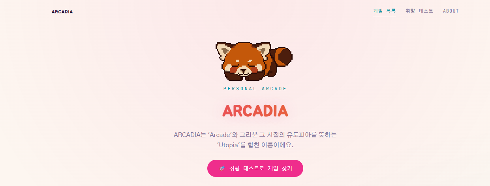
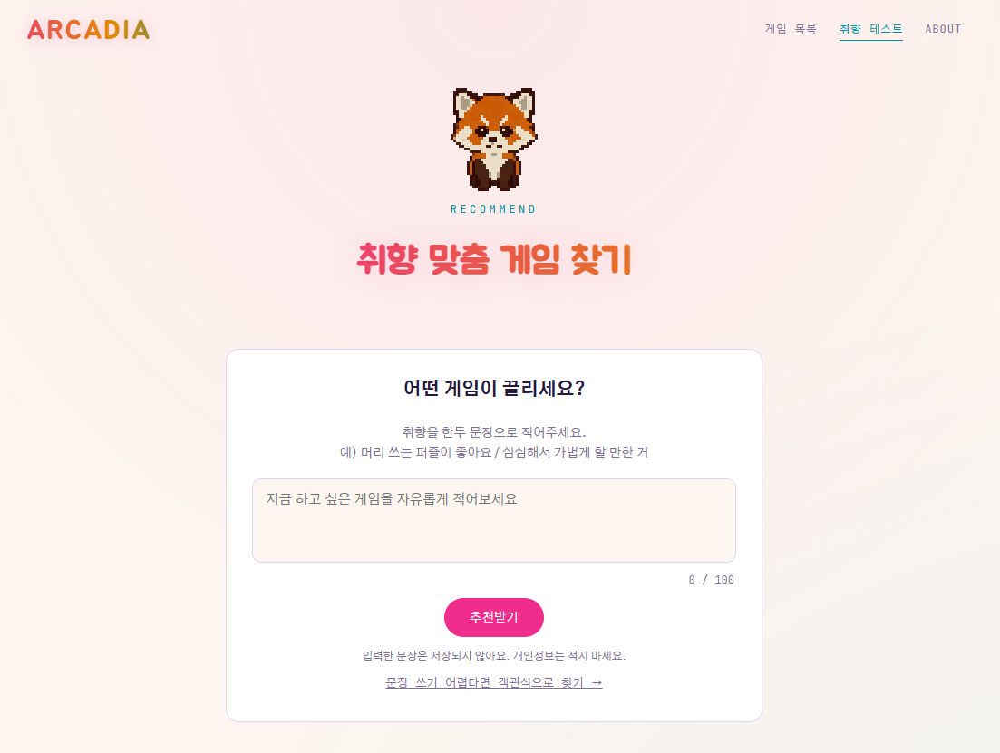
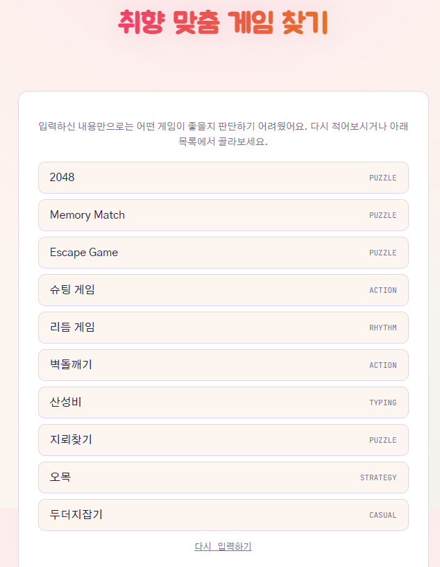
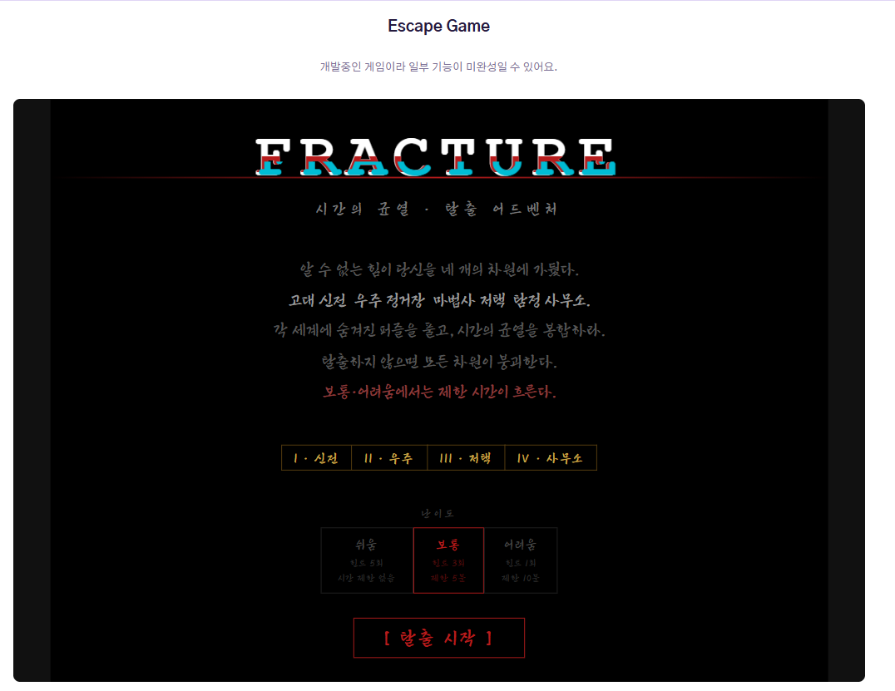

# ARCADIA

그리운 그 시절처럼, 직접 만든 미니게임들을 한곳에 모아둔 개인 아케이드 웹사이트입니다.

**🎮 바로 해보기 → [gugaeun.github.io/mini-game-hub](https://gugaeun.github.io/mini-game-hub/)**

[](https://gugaeun.github.io/mini-game-hub/)

- 게임 **10개** (퍼즐 · 액션 · 리듬 · 타자 · 전략 · 캐주얼)
- **취향 맞춤 추천**: 문장으로 취향을 적거나 객관식 문답에 답하면 어울리는 게임을 추천해줍니다
- React + Vite, 정적 사이트(GitHub Pages)로 배포 — 설치 없이 바로 플레이

## 스크린샷

### 취향 맞춤 게임 찾기

한두 문장으로 취향을 적으면 어울리는 게임을 추천해 줍니다.



문장만으로 판단하기 어려우면 전체 게임 목록에서 직접 고를 수 있습니다.



### Escape Game (FRACTURE)

네 개의 차원을 넘나드는 탈출 어드벤처입니다. (개발 중)



## 게임 목록 (10개)

| 게임 | 장르 | 구현 | 상태 |
| --- | --- | --- | --- |
| 2048 | Puzzle | 기존 HTML/JS (iframe) | 완성 |
| Memory Match | Puzzle | 기존 HTML/JS (iframe, 15단계) | 완성 |
| Escape Game | Puzzle | 기존 HTML/JS (iframe) | 개발 중 |
| 슈팅 게임 | Action | React + Canvas | 완성 |
| 벽돌깨기 | Action | React + Canvas | 완성 |
| 리듬 게임 | Rhythm | React + Canvas + WebAudio 합성 음악 (6단계, 4단계부터 6레인) | 완성 |
| 산성비 | Typing | React + Canvas | 완성 |
| 지뢰찾기 | Puzzle | React (DOM) | 완성 |
| 오목 | Strategy | React + Canvas (컴퓨터 대전 AI) | 완성 |
| 두더지잡기 | Casual | React (DOM) | 완성 |

직접 만든 게임(슈팅·벽돌깨기·리듬·산성비·지뢰찾기·오목·두더지잡기)의 규칙/판정은 화면과 분리된 `src/lib/*Engine.js` 에 있고,
`npm test` 로 화면 없이 시뮬레이션 테스트를 실행할 수 있습니다.

## 폴더 구조

```
src/
  data/games.js          게임 목록 (제목, 장르, 상태, 추천용 태그) — 여기만 고치면 홈 카드가 자동 반영됨
  data/quiz.js           취향 문답 문항과 채점
  lib/*Engine.js         게임별 규칙·판정 로직 (화면과 분리, 테스트 가능)
  lib/recommend.js       문장 입력 기반 게임 추천 (키워드 매칭 / 서버리스 AI 연동)
  pages/                 화면(홈, About, 추천, 게임별 페이지)
  components/            Mascot, NavBar, 추천 패널·팝업 등
public/
  games/                 기존 HTML/JS 게임 (iframe 으로 보여줌)
  mascot/                마스코트 도트 이미지
serverless/              추천 AI 연동용 서버리스 중계 함수 코드 (Cloudflare Worker)
tests/                   게임 엔진 시뮬레이션 테스트
docs/                    README용 이미지
```

기존에 만들어 둔 게임(2048, Memory Match, Escape Game)은 코드를 거의 건드리지 않고 `public/games/` 에 두고
`<iframe>` 으로 감싸 보여줍니다. React 로 새로 포팅하지 않고 그대로 재사용하는 방식입니다.

## 로컬 실행

```bash
npm install
npm run dev
```

터미널에 나온 주소 끝에 `/mini-game-hub/` 를 붙여 열면 됩니다. (예: `http://localhost:5173/mini-game-hub/`)

테스트:

```bash
npm test
```

## GitHub Pages 배포

프로젝트 사이트(`/mini-game-hub` 하위 경로)로 배포합니다. `vite.config.js` 의 `base: '/mini-game-hub/'` 가 저장소 이름과 같아야 합니다.

```bash
npm run deploy
```

빌드 후 `gh-pages` 브랜치로 올라가고, 저장소 Settings → Pages 의 소스를 `gh-pages` / `(root)` 로 지정해 두었습니다.
코드를 고친 뒤에는 `main` 에 push 하고, 사이트에 반영하려면 `npm run deploy` 를 다시 실행합니다.

## 새 게임 추가하기

1. `src/pages/` 에 새 게임 컴포넌트 작성 (규칙은 `src/lib/` 에 엔진으로 분리하면 테스트하기 좋습니다)
2. `src/App.jsx` 에 라우트 추가
3. `src/data/games.js` 에 카드 항목 추가 — 홈 화면과 추천 기능에 자동으로 나타납니다 (`tags`, `keywords` 도 채워주세요)

## 게임 추천 기능

방문자가 취향을 한두 문장으로 입력하면 게임 1개와 추천 이유를 보여줍니다 (`/quiz` 페이지와 첫 방문 팝업).

- **지금 동작 방식**: 브라우저 안의 키워드 매칭(규칙 기반). 객관식 문답 모드도 제공합니다.
- **AI(LLM) 연동**: 서버리스 중계 함수 코드는 `serverless/` 에 작성되어 있습니다.
  **LLM API 키 발급과 배포는 아직 하지 않았고, 이후 진행 예정**입니다.
  연동하려면 `VITE_RECOMMEND_API_URL` 에 배포한 함수 주소를 설정합니다. 자세한 순서는 [serverless/README.md](serverless/README.md) 참고.

## 에셋 출처

- **마스코트(레서판다 픽셀 캐릭터)**: AI 픽셀아트 생성 서비스 [PixelLab](https://www.pixellab.ai)에서 직접 작성한 설명문으로 생성했습니다. 서비스 약관([Terms of Service](https://www.pixellab.ai/termsofservice), 2025-11-23 개정본) 1.3·3.3항에 따라 생성물의 저작권은 사용자에게 있으며 상업·비상업 용도로 허락 없이 사용할 수 있습니다. (생성물로 다른 AI 모델을 학습시키는 것은 금지되어 있습니다.) 원본 GIF와 사이트용 파일은 `public/mascot/` 에 있습니다.
- **게임 효과음·음악**: 외부 파일 없이 WebAudio로 코드에서 합성합니다.
- **폰트**: Google Fonts (Jua, Gothic A1, JetBrains Mono).
